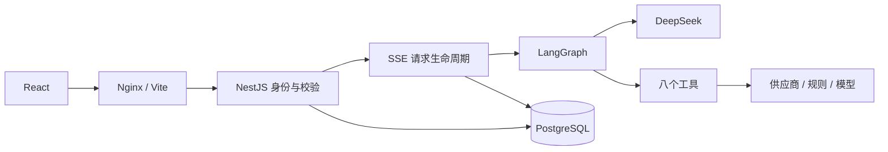
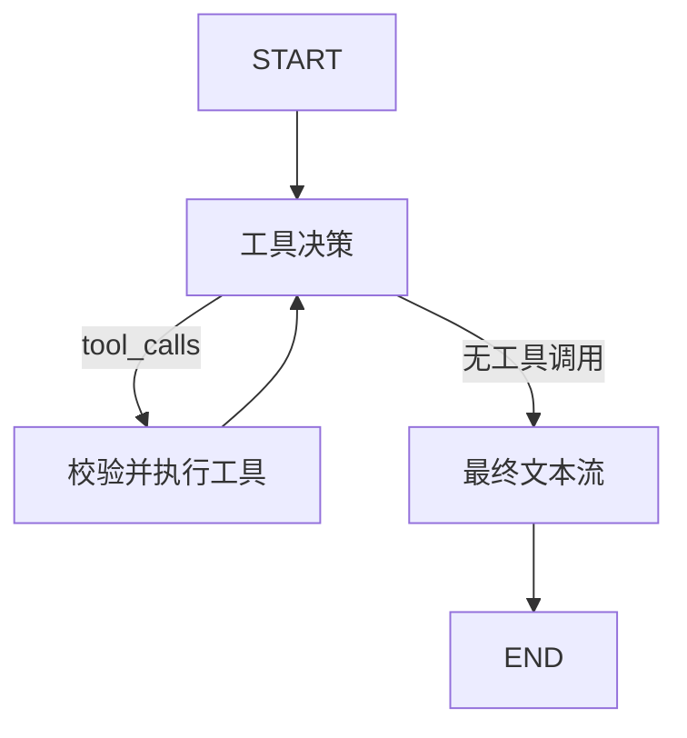

# 架构与代码导读

## 依赖方向

web → shared，api → shared。shared 不得依赖 React、NestJS、Prisma 或环境变量。共享数据是 API 契约和业务 Schema，不是把数据库实体全量发给浏览器。例如 User.passwordHash 永远不返回，AuthService 只返回 id 和 email。

`tools.ts` 集中定义八个输入、数据模式、结果封装；`chat.ts` 定义聊天请求、记忆和 SSE 事件；`sse.ts` 负责增量解码。Zod 在前端用于反馈，在后端用于安全校验；TypeScript 类型不能替代运行时解析。

## 一次消息的生命周期

1. ChatWorkspace 生成 requestId，追加本地用户消息和空助手消息。
2. fetch POST 携带认证头和 JSON。EventSource 不满足本项目的 POST 与自定义认证头需求。
3. AuthGuard 校验 token 的签发者、受众、有效期及用户存在性，注入服务端身份。
4. StreamController 同步占用每用户生成名额，再校验会话所有权和幂等键。
5. 数据库事务创建请求、用户消息和 running 助手消息；必要时新建会话。
6. 开始 SSE，meta 返回会话 ID，加载最近历史和长期偏好。
7. Agent 发出 token、tool_start、tool_result；传输层分配 requestId 与递增 seq。
8. 完成时先事务保存回答与 complete 状态，再发送 done。前端据事件更新消息和工具卡片。

## LangGraph

`graph.ts` 使用 StateGraph 与 Annotation。messages 的 reducer 追加消息，rounds 和 answer 使用替换 reducer。每个 ToolMessage 必须对应 tool_call_id。

决策阶段用 bindTools().invoke，最终阶段用无工具模型 stream。这样不会把模型在工具调用前的中间文字混入最终回答；代价是多一次模型调用和更长的首 token 等待。最多 4 轮、每轮 8 个工具，Graph recursionLimit=16。

工具 Schema 提供给模型帮助生成参数，但服务端执行前仍重新解析；身份和 AbortSignal 在闭包内传递，不是模型可填写参数。demo 分支不初始化模型，生成明确标记的样例文本；演示工具经表单直接调用。

## SSE、取消和恢复

浏览器停止调用 AbortController，服务端监听 response close，向模型和供应商传播取消。总生成超时 180 秒，直接工具超时 60 秒，外部 HTTP 超时 12 秒。finally 清理定时器、监听器和并发占位。

正常完成写 complete，客户端取消或超时写 interrupted，其他错误写 failed。取消后尽力保存已接收的部分内容。进程硬崩溃无法 finally，启动时将遗留 running 请求标记 interrupted；尚未最终落库的增量可能丢失。

连接事件 seq 不等于可恢复的消息游标。本版不重放历史 SSE，断线后查询会话获取持久化文本。工具完整卡片只在当前连接展示；数据库只记录工具模式、状态、错误码和耗时的脱敏摘要。

## 幂等与并发

ChatRequest.id 是全局 UUID 主键。先查后插不能防竞态，最后依赖数据库约束和事务。重复请求返回 409，不再次调用模型。每用户生成锁必须在第一个 await 前占用，集成测试覆盖不同请求 ID 的竞争。

锁与限流是进程内机制，因此部署限定一个 API 实例。多实例需要数据库租约或 Redis 共享锁、独立的恢复所有权和用户级费用控制，不能直接扩副本。

## 记忆

短期：读取最近最多 40 条 complete 消息，按 16000 字符预算从新到旧选择。字符不是精确 token；本版采用有界历史截断，不做额外 LLM 摘要，避免摘要费用和未校验事实混入。

长期：六类白名单偏好，以 `(userId,key)` 去重；用户显式确认保存，同类型再次保存即更新。只保存 interests、pace、budgetLevel、diet、homeCity、language，最长 300 字符。没有自动抽取护照、账户信息，也不把整段聊天写入偏好。

偏好和工具结果均为不可信数据，提示词不得接受它们改写系统规则。字段白名单无法识别 value 内全部敏感内容，界面提醒用户避免填写敏感信息。生产可增加敏感数据检测。结构化偏好足够满足本版需求，因此无需向量数据库；pgvector 可作为后续检索扩展，但不能替代授权。

## 数据结构

User → Conversation → Message；User → UserMemory；User/Conversation → ChatRequest → ToolExecution。删除账号级联清理全部资源，删除会话清理消息和工具执行，长期偏好独立保留。

Conversation(userId,updatedAt) 用于会话列表；Message(conversationId,createdAt) 用于历史；ChatRequest(userId,status) 用于状态；UserMemory(userId,key) 保证偏好唯一。事务中消息时间可能相同，读取增加角色排序，保证用户在助手之前。

## 安全边界

bcryptjs cost=12；JWT 两小时、签发者与受众校验；token 仅内存；Guard 下的全部资源按 userId 过滤；错误不暴露数据库原始异常；32KB JSON 限制；Helmet；Markdown 禁用 HTML；供应商固定 HTTPS 域名、禁跳转、2MB 响应上限。

限流按可信代理链解析的 IP：auth 20/分钟，其余 120/分钟。宿主机直连默认 TRUST_PROXY_HOPS=0，本地 Nginx=1，云端 Caddy→Nginx=2。Nginx 追加直接来源，Caddy 在公网入口覆盖 X-Forwarded-For，API 不直接暴露，避免用户伪造前缀绕过限流。改变代理拓扑时必须同步修改该值，不同长度的旁路不能共享相同信任跳数。限流仍是单进程状态，高并发需共享配额。

前端 RequestScope 将列表与删除回调绑定到账号会话。退出会关闭 scope、取消请求并丢弃迟到响应，避免账号 A 的标题回填到账号 B。历史消息加载也检查 AbortSignal，旧请求不得清除新请求的 loading。

NestJS 启动通过单个 AppModule 注册模块化目录内的控制器和服务，明确 @Inject，兼容 tsx 与生产 tsc 的装饰器差异。复杂度增长后可把目录提取为独立 Nest Module，保持接口不变。
